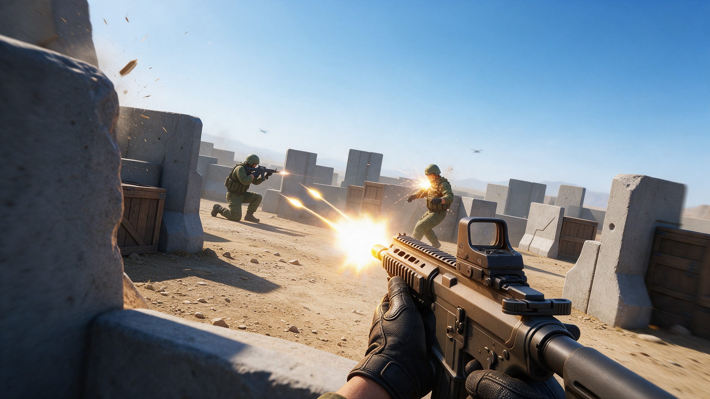

# Simple Animated FPS NPC Template

A compact first-person combat slice: rifle and pistol gunplay against animated enemy soldiers who fire back.

Use it as a starting point for a 3D shooter, an enemy encounter prototype, or a weapon handling experiment. Keep the pieces you need, replace the blockout arena or assets, and extend the scripts into your own combat loop.

## What's inside

- First-person player controller with mouse look, jump, sprint, crouch, stamina and camera FOV feedback.
- Hitscan weapon system with ammo, reloads, aim down sights, recoil and camera shake, bullet tracers, muzzle flash and weapon switching.
- Animated first-person rifle and pistol viewmodels, with weapon profiles in `res://weapons/` you can copy and tune.
- Ranged soldier NPCs with idle, movement, shooting, hit reaction and death animations.
- A prototype arena in `res://main.tscn` with cover, lighting, a HUD and enemy placements.
- Full keyboard, mouse and gamepad bindings, plus a smoke test at `res://tests/input_reader_smoke_test.gd`.

## Get started

1. [Download the ZIP](https://github.com/SummerEngine/template-3d-fps-simple-animated-npc/archive/refs/heads/main.zip) or clone the repo:
   `git clone https://github.com/SummerEngine/template-3d-fps-simple-animated-npc.git`
2. Open the folder in [Summer Engine](https://www.summerengine.com/download).
3. Press Play. The first click captures the mouse; press Esc to release it.

Summer's AI agent can extend it for you. Try asking:

- "Add a shotgun with spread and a slower reload, and put it in weapon slot 3."
- "Make the soldiers take cover and flank the player when they get hit."
- "Turn the arena into a wave survival mode with a score counter."

## Controls

| Action | Keyboard and Mouse |
|---|---|
| Move | W, A, S, D |
| Look | Mouse |
| Jump | Space |
| Sprint | Shift |
| Crouch | C |
| Shoot | Left mouse button |
| Aim | Right mouse button |
| Reload | R |
| Equip weapon 1 | 1 |
| Equip weapon 2 | 2 |
| Release mouse pointer | Esc |
| Recapture mouse pointer | Left mouse button |

Gamepad mappings are included for movement, look, jump, crouch, shoot, reload and weapon slots. You can change all mappings in `project.godot` under `[input]` or in the input map UI.

## Building on it

- Edit `res://main.tscn` to reshape the arena, move enemies, or replace the blockout layout with your own level.
- Tune player movement in `res://scripts/player_controller.gd`.
- Add weapons by creating more `FPSWeaponProfile` resources like `res://weapons/rifle_01_profile.tres` and wiring them into the player's `WeaponLoadout`.
- Extend enemy behavior in `res://scripts/enemy_npc.gd` and enemy firing in `res://scripts/enemy_ranged_weapon.gd`.
- Use `res://scripts/fps_input_reader.gd` as the central place for remappable player input.

## Credits

Asset sources and licenses are listed in [`asset_manifest/fps_combat_assets.md`](asset_manifest/fps_combat_assets.md). Highlights:

- Enemy soldier model: Sketchfab "British Soldier" source (CC BY 4.0), rigged and animated through Mixamo (Mixamo terms apply).
- Skybox and ground textures: Kenney (kenney.nl), CC0.
- Prototype textures: Godot Asset Library asset 781, CC0.
- Rifle audio: CC0 audio source.

Keep these license requirements in mind when you replace or ship assets.
